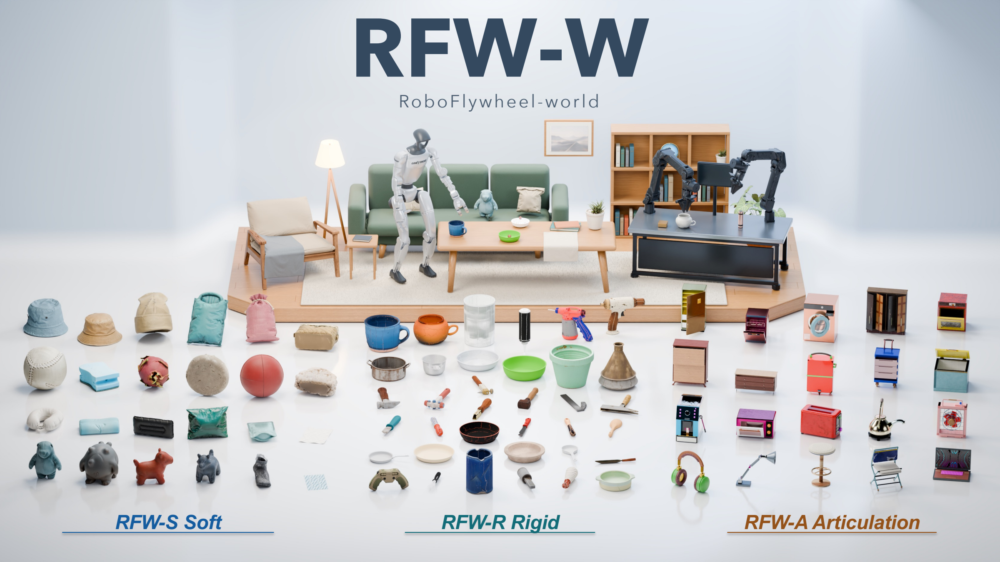

<div align="center">

# RFW-W: Scaling Physical Asset Universes for Generative Embodied Simulation

Jiawei Weng<sup>1,&#42;</sup>, Rui Zhang<sup>1,2,&#42;</sup>, Saining Zhang<sup>2,3,&#42;,†</sup>, Changjian Pan<sup>2,4,&#42;</sup>, Yuanbo Lyu<sup>1,&#42;</sup>, Jiarui Guo<sup>1,2,&#42;</sup>,
Yongzhi Li<sup>3</sup>, Guolin Liu<sup>2</sup>, Jialu Liu<sup>2</sup>, Jiankun Wang<sup>2</sup>, Yi Yang<sup>1</sup>, Peishuo Li<sup>3</sup>,
Zhiheng Li<sup>2</sup>, Jiaying Wan<sup>2</sup>, Junhao Chen<sup>2</sup>, Weiqing Xiao<sup>5</sup>, Jingrun Du<sup>1,2</sup>, Wenyi Li<sup>1,2</sup>, Weiyi Lin<sup>1</sup>,
Zenan Meng<sup>1,‡</sup>, Hu Wei<sup>1,‡</sup>, Lin Qu<sup>1</sup>, Zongzheng Zhang<sup>2</sup>, Hao Zhao<sup>2</sup>, Chaojian Li<sup>6,‡</sup>

<sup>1</sup> Alibaba Group &nbsp; <sup>2</sup> Tsinghua University &nbsp; <sup>3</sup> Nanyang Technological University<br>
<sup>4</sup> Peking University &nbsp; <sup>5</sup> Nanjing University &nbsp; <sup>6</sup> Hong Kong University of Science and Technology

<sub>&#42; Core contributors &nbsp; † Project leader &nbsp; ‡ Corresponding authors</sub>

</div>

<p align="center">
  <a href="https://roboflywheel-com.github.io/RoboFlywheel-World/"></a>
  
  <a href="https://modelscope.cn/datasets/RoboFlywheel/RoboFlywheel-Rigid"></a>
  <a href="LICENSE"></a>
</p>

<p align="center">
  <br>
  <sub><a href="https://roboflywheel-com.github.io/RoboFlywheel-World/">Watch the full demo</a> &nbsp;·&nbsp; <a href="https://roboflywheel-com.github.io/RoboFlywheel-World/#assets">Explore rigid assets in 3D</a> &nbsp;·&nbsp; <a href="https://roboflywheel-com.github.io/RoboFlywheel-World/#scenes">Watch scene recordings</a></sub>
</p>

**RoboFlywheel-World (RFW-W)** builds simulation-ready objects and assembles them into scenes around a specified task. This repository contains the rigid asset and scene generation pipelines. In the **RFW-R** rigid asset dataset, each object's textured mesh is paired with its functional parts, collision geometry, and physical properties.

| Retained rigid assets | Object categories | Hand models used for grasp annotation |
|:---:|:---:|:---:|
| **524,611** | **1,212** | **6** |

## From Assets to Scenes

- **[Rigid asset generation](src/rfw_w/assets/):** Start with text, an image, or an existing mesh. The pipeline checks the surface from multiple views, labels functional parts, builds collision geometry, and exports the asset for use in different simulators through URDF, MJCF, or USD.
- **[Task-conditioned scene generation](src/rfw_w/scenes/):** Retrieve the target objects and their supports, fix their relative poses, then fit walls, openings, and furniture around them. The final checks cover geometry and task constraints.

## Installation

Run these commands from the repository root with Python 3.10 or later. The base installation is enough for the task preview below; it requires no GPU, model service, or asset library.

```bash
python3 -m venv .venv
source .venv/bin/activate
python -m pip install -e .
rfw-w doctor
```

## Reproduction

**Preview a built-in task.** Compile the office cup-picking task into a structured specification. This step does not render a scene or execute robot actions. Use a new output directory for each run.

```bash
rfw-w scene generate --experiment office_pick_cup --compile-only --output-dir outputs/preview-001
```

**Generate and validate an asset.** Install the geometry, export, and MuJoCo dependencies below. Use the [asset runtime template](examples/assets/runtime.example.json) to configure model services, weights, and workers. Keep the local configuration outside the repository and set `ASSET_RUNTIME` to its path before running the commands.

```bash
python -m pip install -e '.[asset-geometry,scene-geometry,usd,mujoco]'
rfw-w asset generate --request examples/assets/request.json --config "$ASSET_RUNTIME" --out outputs/asset-001
rfw-w asset validate --bundle outputs/asset-001/package --out outputs/asset-check-001 --steps 600
```

**Run the asset-to-scene workflow.** Use the [workflow configuration template](examples/reproduction/runtime.example.json) to specify the task, the resources for asset binding, and the Python environment for each simulator. Set `REPRO_RUNTIME` to the resulting configuration file, then run:

```bash
python scripts/reproduce.py --config "$REPRO_RUNTIME" --out outputs/reproduction-001
```

Loading an asset and stepping the simulation do not establish that a robot can complete the task. Model-estimated physical properties are not material measurements.

## License

The original source code is licensed under [Apache-2.0](LICENSE). See [NOTICE](NOTICE) for attributions. External software, model weights, and datasets are subject to their [respective license terms](THIRD_PARTY.md).
